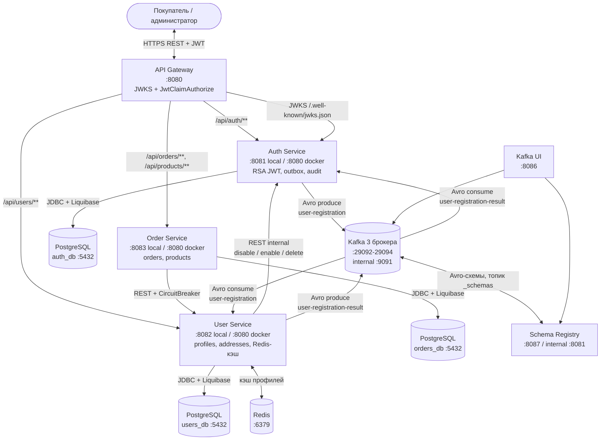

# Lab 7 — E-Commerce приложение

## Сервисы и порты

| Сервис | Локальный порт | Docker-порт | БД |
|---|---|---|---|
| api-gateway | 8080 | 8080 | — |
| auth-service | 8081 | 8080 | auth_db (Postgres) |
| user-service | 8082 | 8080 | users_db (Postgres) + Redis |
| order-service | 8083 | 8080 | orders_db (Postgres) |
| kafka-broker-0/1/2 | 29092 / 29093 / 29094 | 9091 (internal) | KRaft, 3 брокера, RF=3 |
| schema-registry | 8087 | 8081 (internal) | Avro + Schema Registry |
| kafka-ui | 8086 | 8080 | Kafka UI |

## Архитектура



## Запуск в Docker

Образы `auth-service`, `user-service`, `order-service` и `api-gateway` собираются из исходников внутри Docker (multi-stage Maven build), предварительный `mvn package` не нужен.

```bash
cp .env.example .env
docker compose build
docker compose up -d
```

При повторной сборке Maven-зависимости берутся из BuildKit-кэша, а локальные образы `shoplab/*:local` переиспользуются без пулла. Инфраструктурные образы (`postgres`, `kafka`, `redis`, `liquibase`) скачиваются Docker-ом только при первом запуске и дальше берутся из локального кэша.

### Swagger UI

Единый Swagger UI с API всех сервисов доступен на API Gateway:

```text
http://localhost:8080/swagger-ui.html
```

По умолчанию открывается объединённая спецификация `All Services` со всеми роутами. В выпадающем списке также можно отдельно посмотреть API каждого сервиса.

Спецификации OpenAPI:

```text
http://localhost:8080/openapi/all
http://localhost:8080/openapi/auth
http://localhost:8080/openapi/users
http://localhost:8080/openapi/orders
```

Для защищённых методов получите `accessToken` через `POST /api/auth/login`, нажмите `Authorize` в Swagger UI и вставьте токен.
