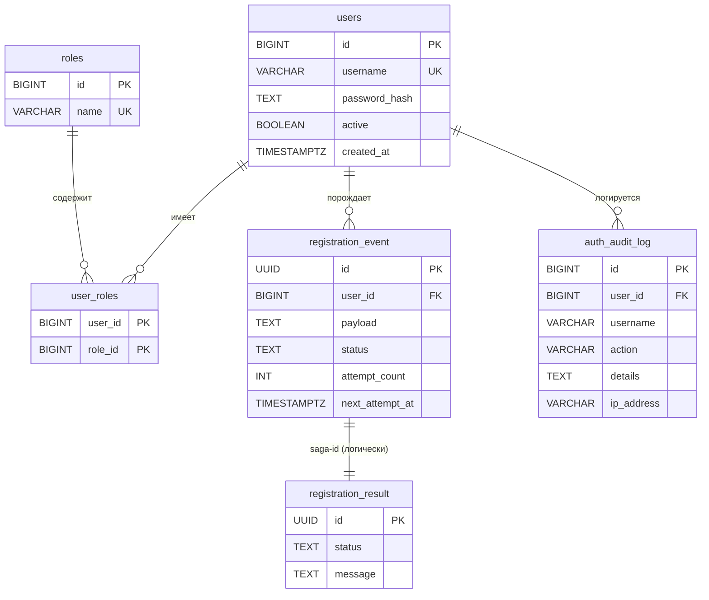
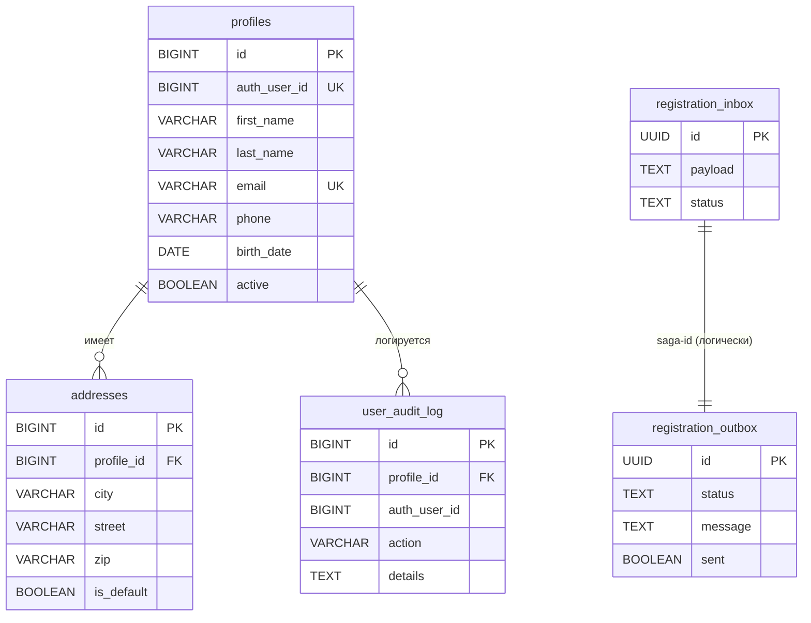
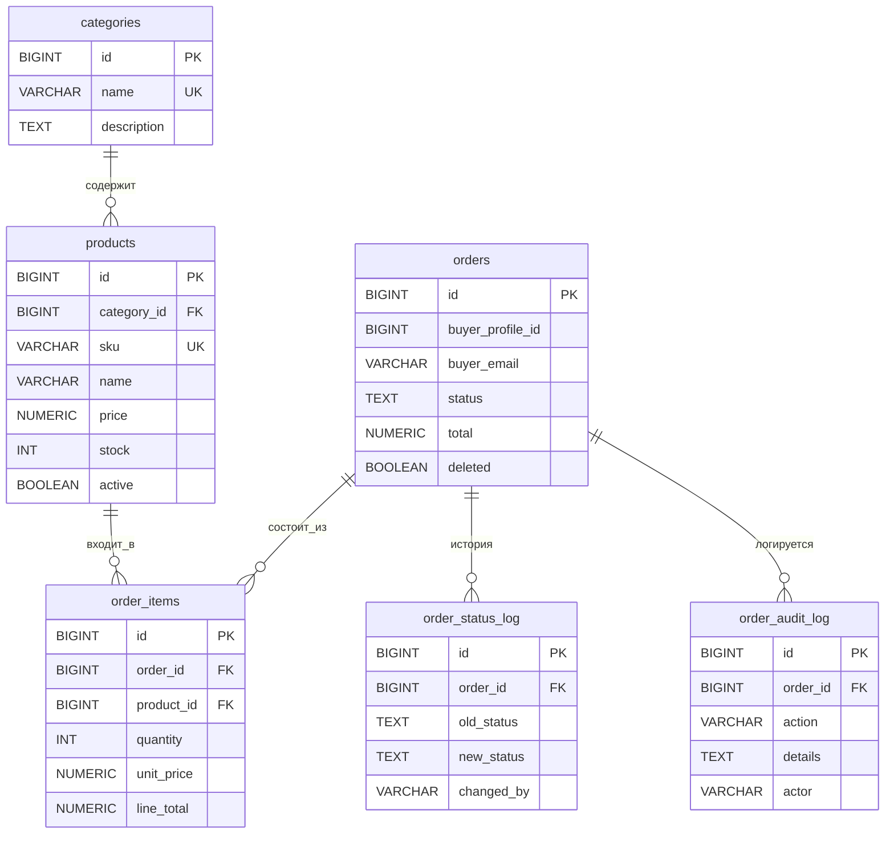
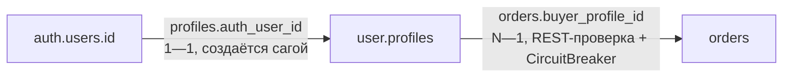

# ER-структура данных

## auth_db

- users(1)—(N)user_roles(N)—(1)roles: многие-ко-многим через связку.
- registration_event(N)—(1)users: событие принадлежит пользователю;
  при компенсации (FAIL) связь обнуляется, пользователь удаляется.
- auth_audit_log(N)—(1)users: событие журнала опционально привязано к пользователю
  (NULL для анонимных попыток логина).

## users_db

- profiles(1)—(N)addresses: каскадное удаление адресов вместе с профилем.
- user_audit_log(N)—(1)profiles: SET NULL при удалении профиля.

## orders_db

- order_items — связка «многие-ко-многим» заказов и товаров с атрибутами
  (quantity, unit_price, line_total); удаление заказа каскадит позиции;
  товар удалить нельзя, пока есть позиции (RESTRICT).
- order_status_log — история переходов статусов (old→new, кто, когда).

## Межсервисные (логические, без FK)

- `profiles.auth_user_id → auth.users.id` (1—1, создаётся сагой).
- `orders.buyer_profile_id → user.profiles.id` (N—1, проверяется REST-вызовом
  перед созданием заказа )
