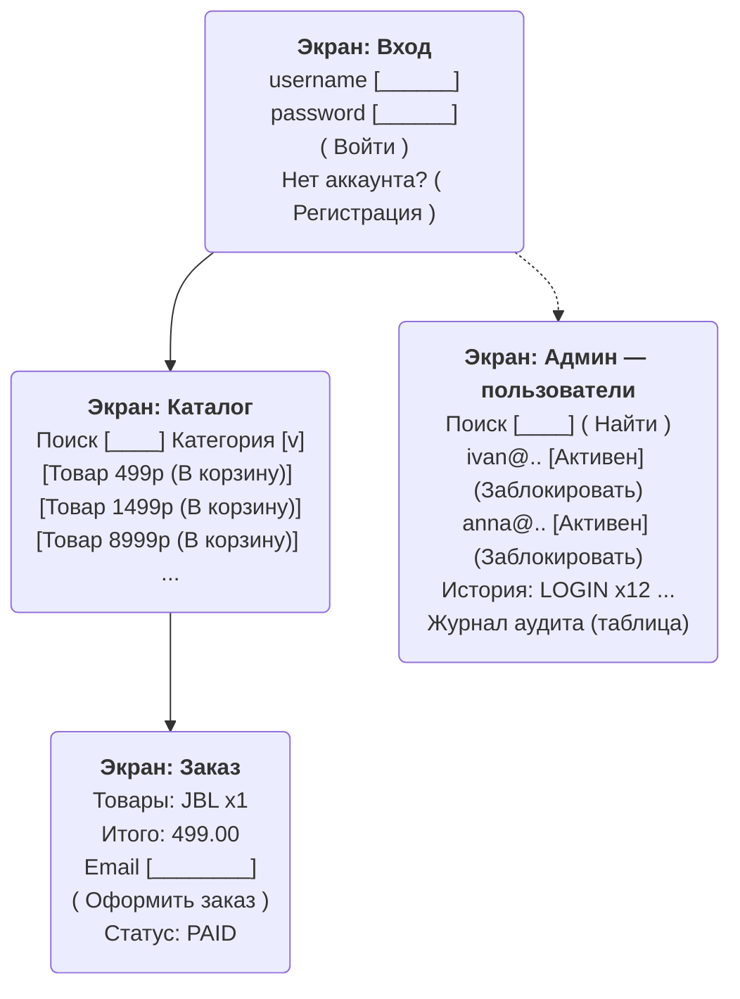

# Журналирование событий и интерфейсы

- `auth_db.auth_audit_log`: SIGNUP_INITIATED, LOGIN, LOGIN_FAILED, LOGIN_BLOCKED,
  TOKEN_REFRESH, ENABLE/DISABLE/DELETE. Колонки: user_id, username, action, details, ip_address.
- `users_db.user_audit_log`: SAGA_PROFILE_CREATED, PROFILE_UPDATE, ACTIVATE/DEACTIVATE,
  PROFILE_DELETE. Колонки: profile_id, auth_user_id, action, details.
- `orders_db.order_status_log`: каждый переход old→new и changed_by.
- `orders_db.order_audit_log`: ORDER_CREATED/STATUS_*/ORDER_DELETED + details + actor.

Каждая запись — `AuditLogRepository.log / SagaAuditRepository.audit /
OrderJdbcRepository.audit` внутри тех же транзакций, что и само действие

## Готовые audit-выборки

- Последние N событий пользователя: `... WHERE user_id=? ORDER BY created_at DESC LIMIT ?`
  (индекс `idx_auth_audit_user_time`).
- События действия за период: `... WHERE action=? AND created_at>=? ...`
  (индекс `idx_auth_audit_action_time`).
- Топ активных: `GROUP BY username ORDER BY COUNT(*) DESC` (см. лабу 5).
- История заказа: `SELECT old_status,new_status,changed_by,created_at FROM
  order_status_log WHERE order_id=? ORDER BY created_at` (индекс `idx_status_log_order_time`).

## Проволочные интерфейсы (схемы экранов)

