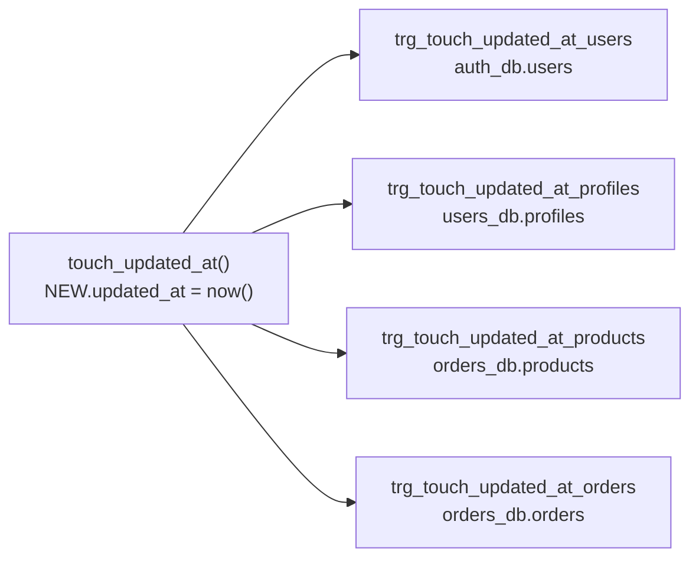

# Физическая структура БД

## auth_db

- `roles(id BIGINT IDENTITY PK, name VARCHAR(50) UNIQUE)`; seed: ADMIN, USER.
- `users(id IDENTITY PK, username VARCHAR(100) UNIQUE NOT NULL,
  password_hash TEXT NOT NULL, active BOOL DEFAULT FALSE,
  created_at/updated_at TIMESTAMPTZ)`.
- `user_roles(user_id → users CASCADE, role_id → roles RESTRICT, PK(user_id,role_id))`.
- `registration_event(id UUID PK, user_id → users SET NULL, payload TEXT NOT NULL,
  status CHECK(CREATED,PRE_SENDING,SENDING,SUCCESS,FAIL,FAIL_TO_SEND),
  attempt_count INT, next_attempt_at, sending_started_at, created_at, updated_at)`.
- `registration_result(id UUID PK, status, message, created_at)`.
- `auth_audit_log(id IDENTITY PK, user_id → users SET NULL, username, action,
  details, ip_address, created_at DEFAULT now())`.
- Индексы: `idx_users_username`, `idx_users_active`, `idx_user_roles_user/role`,
  `idx_reg_event_status_next(status,next_attempt_at)`,
  `idx_auth_audit_user_time`, `idx_auth_audit_action_time`.

## users_db

- `profiles(id IDENTITY PK, auth_user_id BIGINT UNIQUE NOT NULL,
  first_name/last_name NOT NULL, email UNIQUE NOT NULL, phone, birth_date NOT NULL,
  active BOOL, created_at/updated_at)`.
- `addresses(id IDENTITY PK, profile_id → profiles CASCADE, city, street, zip,
  is_default BOOL, created_at)`.
- `registration_inbox(id UUID PK, payload, status, created_at)`,
  `registration_outbox(id UUID PK, status, message, sent BOOL, attempt_count,
  next_attempt_at, created_at)`.
- `user_audit_log(id IDENTITY PK, profile_id → profiles SET NULL, auth_user_id,
  action, details, created_at)`.
- Индексы: `idx_profiles_email`, `idx_profiles_auth_id`, `idx_profiles_active`,
  `idx_profiles_last_name`, `idx_addresses_profile`, `idx_reg_outbox_sent_next`.

## orders_db

- `categories(id IDENTITY PK, name UNIQUE, description)`.
- `products(id IDENTITY PK, category_id → categories RESTRICT, sku UNIQUE NOT NULL,
  name, price NUMERIC(12,2) CHECK>=0, stock INT CHECK>=0, active BOOL, created_at/updated_at)`.
- `orders(id IDENTITY PK, buyer_profile_id BIGINT NOT NULL (логический FK),
  buyer_email, status CHECK(CREATED,PAID,SHIPPED,DELIVERED,CANCELLED),
  total CHECK>=0, deleted BOOL, created_at/updated_at)`.
- `order_items(id IDENTITY PK, order_id → orders CASCADE, product_id → products RESTRICT,
  quantity CHECK>0, unit_price, line_total)`.
- `order_status_log(id IDENTITY PK, order_id → orders CASCADE, old_status, new_status, changed_by, created_at)`,
  `order_audit_log(id IDENTITY PK, order_id → orders SET NULL, action, details, actor, created_at)`.
- Индексы: `idx_products_category/sku/active_price`, `idx_orders_buyer/email`,
  `idx_orders_status_created(status,created_at)`, частичный `idx_orders_deleted WHERE NOT deleted`,
  `idx_items_order/product`, `idx_status_log_order_time`.

Типы: деньги — `NUMERIC(12,2)`, время — `TIMESTAMPTZ`, идентификаторы саги — `UUID`.

## Триггеры

Функция `touch_updated_at()` создана в каждой из трех БД, к ней привязаны
4 триггера `BEFORE UPDATE FOR EACH ROW`:

Миграции: `auth-service/migrations/009_touch_updated_at.sql` (changeset `auth-009`),
`user-service/migrations/007_touch_updated_at.sql` (`user-007`),
`order-service/migrations/007_touch_updated_at.sql` (`order-007`).
Любой `UPDATE` этих таблиц проставляет свежее `updated_at` на стороне БД,
поэтому в `UPDATE`-запросах репозиториев ручного `updated_at = now()` нет.
На `INSERT` триггер не срабатывает, время создания ставит `DEFAULT now()`.
